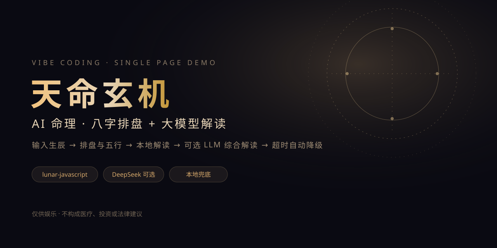
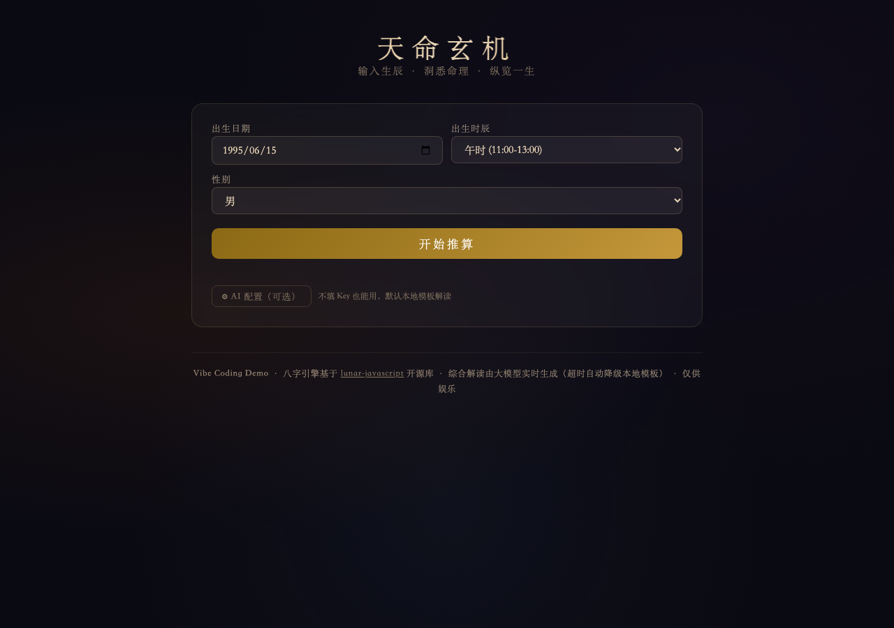
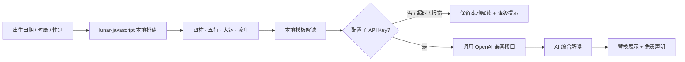

<p align="center">
  <a href="https://echozmecin-commits.github.io/ai-mingli/">
    
  </a>
</p>

<h1 align="center">天命玄机 · AI 命理</h1>

<p align="center">
  输入生辰，先用本地规则完成八字排盘与解读，再可选调用大模型生成综合解读；没有 Key 或请求失败时自动降级，核心体验不依赖网络。
</p>

<p align="center">
  <a href="https://echozmecin-commits.github.io/ai-mingli/"><strong>在线体验</strong></a> ·
  <a href="#快速开始">快速开始</a> ·
  <a href="#隐私与边界">隐私与边界</a> ·
  <a href="#license">License</a>
</p>

<p align="center">
  
  
  
  
</p>

## 这是什么

一个单页 AI 产品 Demo：用户输入公历出生日期、时辰和性别，页面用 `lunar-javascript` 在本地排八字、算五行和运势曲线，并生成事业、感情、财运、健康四类解读。配置 API Key 后，再调用大模型生成一段综合解读；没有 Key、超时或接口报错时，保留本地解读并显示降级原因。

它想演示的不是“算命准不准”，而是一个 AI 产品的**可靠落地方式**：确定性计算在前，生成式 AI 在后，失败可降级，边界可解释。

## 功能

| 能力 | 说明 |
| --- | --- |
| 本地排盘 | 公历日期 + 时辰 + 性别 → 四柱、五行、纳音、大运、流年 |
| 可视化 | 人生运势曲线、五行分布条形图、逐年数据表 |
| 本地解读 | 事业、感情、财运、健康四类模板解读，不依赖网络 |
| 可选 AI | 支持 Bearer 鉴权的 OpenAI Chat Completions 兼容接口，默认 DeepSeek |
| 降级机制 | 无 Key、20 秒超时、HTTP 错误、空响应都回退到本地模板 |
| 隐私控制 | Key 只存本机 `localStorage`，页面提供“清除 Key”；请求时才会发送到你填写的接口 |

## 截图

<p align="center">
  
</p>

## 架构



## 快速开始

不需要构建工具，直接打开即可：

```bash
# 方式一：直接打开
open index.html

# 方式二：起静态服务器（推荐，AI 模式对 file:// 更友好）
python3 -m http.server 8080
# 打开 http://localhost:8080
```

不配置 Key 也能完整走完排盘和本地解读。要体验 AI：

1. 点击页面里的「⚙ AI 配置（可选）」；
2. 填写接口地址（默认 `https://api.deepseek.com`）、API Key、模型（默认 `deepseek-chat`）；
3. 点击「保存并生成」。

> 浏览器直连要求服务商允许 CORS。DeepSeek 已实测可用；部分服务商（例如 OpenAI 官方 API）不允许浏览器直连，需要自建代理。

## 隐私与边界

- **Key 只保存在本机浏览器**，不会上传到本项目的服务器；但生成时 Key 会随请求发送到你填写的接口地址。
- **生辰信息（日期、时辰、性别）会进入大模型 Prompt**，发送给同一个接口地址，受对方隐私政策约束。
- 页面同时展示“本地解读”和“AI 解读”标识；AI 失败时不会伪装成成功。
- 所有内容仅供娱乐，**不构成医疗、投资、法律或人生决策建议**。健康、财运卡片和 AI 解读附近都有对应提示。

## 已知限制

- 只支持公历日期输入，没有农历输入；没有出生地、真太阳时校正。
- 子时按 23:00 统一处理，早子/晚子未拆分。
- 0–100 的“运势评分”是启发式生成，用于演示可视化，不是科学预测。
- AI 输出可能有幻觉；系统 Prompt 已禁止医疗诊断、投资建议和绝对化断言，但仍需人工判断。
- 单文件 HTML 便于分发，但也意味着样式、排盘、图表、AI 客户端都在一个文件里；见 Roadmap。

## 项目结构

```text
.
├── index.html              # 页面、样式、排盘、图表、AI 客户端
├── lunar.js                # 本地化的 lunar-javascript 依赖
├── docs/images/cover.svg   # README 封面
├── LICENSE                 # MIT
└── THIRD_PARTY_NOTICES.md  # lunar-javascript  attribution
```

## Roadmap

- [x] 本地排盘 + 本地解读 + AI 增强
- [x] 无 Key / 超时 / 错误降级
- [x] 逐年数据表（图表的可访问替代）
- [ ] 拆分 `styles.css`、`app.js` 和排盘/图表/AI 模块
- [ ] 增加出生地 / 真太阳时 / 早子晚子选项
- [ ] 为纯函数补单元测试（评分、URL 规范化、年龄映射）
- [ ] 流式输出与更细的错误分类

## License

代码使用 [MIT License](LICENSE)。`lunar.js` 来自 [6tail/lunar-javascript](https://github.com/6tail/lunar-javascript)，同样为 MIT，详见 [THIRD_PARTY_NOTICES.md](THIRD_PARTY_NOTICES.md)。
